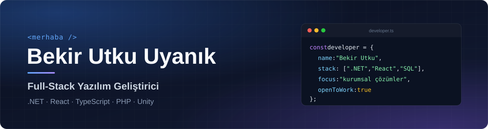
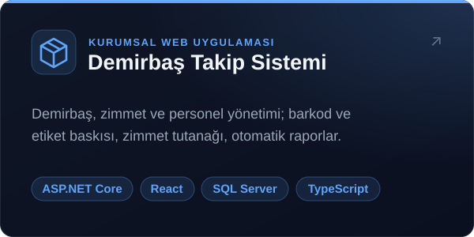
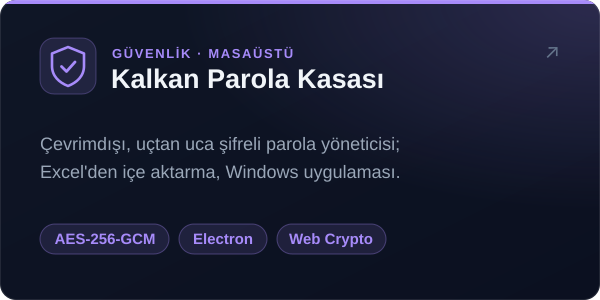
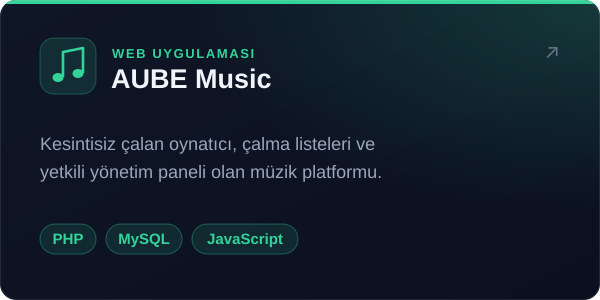
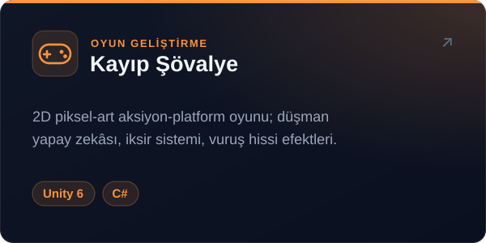

## Hakkımda

Kurumsal iş süreçlerini dijitalleştiren uygulamalar geliştiriyorum. Veritabanı tasarımından
REST API'ye, arayüzden kurulum paketine kadar bir projeyi uçtan uca üstlenebiliyorum.
Önceliğim; okunabilir, sürdürülebilir ve gerçek bir ihtiyacı çözen yazılım.

- **Backend:** ASP.NET Core Web API, Entity Framework Core, SQL Server, JWT kimlik doğrulama
- **Frontend:** React, TypeScript, Vite, Bootstrap
- **Otomasyon:** Hangfire ile zamanlanmış görevler, PDF / Word belge üretimi, SMTP e-posta
- **Güvenlik:** AES-256-GCM şifreleme, çevrimdışı-öncelikli (offline-first) mimari

## Öne Çıkan Projeler

  
  

  
  

## Teknolojiler

  

Ayrıca: Entity Framework Core · Microsoft SQL Server · Hangfire · QuestPDF · Swagger · MariaDB

---

İş birliği ve fırsatlar için <a href="https://www.linkedin.com/in/bekirutkuuyanik/">LinkedIn</a> veya <a href="mailto:b.utku.uyanik@gmail.com">e-posta</a> üzerinden ulaşabilirsiniz.

