# Bekir Utku Uyanık

**Full-Stack Yazılım Geliştirici** · .NET · React · PHP · Unity

Kurumsal iş süreçlerini dijitalleştiren web uygulamaları, güvenlik odaklı masaüstü araçlar ve oyunlar geliştiriyorum.

---

## Hakkımda

Uçtan uca ürün geliştirmeyi seviyorum: veritabanı tasarımından REST API'ye, arayüzden
kurulum paketine kadar bir projenin tamamını üstlenebiliyorum. Önceliğim; okunabilir,
sürdürülebilir ve gerçek bir ihtiyacı çözen yazılım.

- **Kurumsal uygulamalar** — ASP.NET Core Web API, Entity Framework Core, SQL Server, JWT ile kimlik doğrulama
- **Modern ön yüz** — React, TypeScript, Vite, Bootstrap
- **Otomasyon ve raporlama** — Hangfire ile zamanlanmış görevler, PDF / Word belge üretimi, SMTP e-posta
- **Güvenlik** — AES-256-GCM şifreleme, çevrimdışı-öncelikli (offline-first) mimari
- **Oyun geliştirme** — Unity 6 ve C# ile 2D oyun mekanikleri ve düşman yapay zekâsı

---

## Öne Çıkan Projeler

### 🏢 [Demirbaş Takip Sistemi](https://github.com/BekirUtku/projeDemirbas)
Kurumsal demirbaş, zimmet ve personel yönetim sistemi.
Barkod üretimi ve etiket baskısı, Word formatında zimmet tutanağı, Hangfire ile zamanlanmış
doğum günü e-postaları ve yöneticiye PDF özet rapor.

### 🛡️ [Kalkan Parola Kasası](https://github.com/BekirUtku/kalkan)
Çevrimdışı çalışan, uçtan uca şifreli, açık kaynaklı parola yöneticisi.
AES-256-GCM şifreleme, sıfır çalışma zamanı bağımlılığı, Excel'den içe aktarma ve
Windows masaüstü uygulaması.

### 🎵 [AUBE Music](https://github.com/BekirUtku/Muzik-Websitesi-Ve-Uygulamasi)
Framework kullanmadan geliştirilmiş müzik dinleme platformu.
Sayfa geçişlerinde kesintisiz çalan oynatıcı, çalma listeleri, beğeniler ve yetkili yönetim paneli.

### 🎮 [Kayıp Şövalye](https://github.com/BekirUtku/Yapay-Zeka-Destekli-Oyunum)
Unity 6 ile geliştirilmiş 2D piksel-art aksiyon-platform oyunu.
Ortak temel sınıflar üzerine kurulu üç düşman tipi, iksir sistemi ve vuruş hissi (game feel) efektleri.

---

## Teknolojiler

| Alan | Teknolojiler |
|---|---|
| **Diller** | C#, TypeScript, JavaScript, PHP, SQL |
| **Backend** | ASP.NET Core Web API, Entity Framework Core, Hangfire, PHP |
| **Frontend** | React, Vite, Bootstrap, HTML5, CSS3 |
| **Veritabanı** | Microsoft SQL Server, MySQL / MariaDB |
| **Masaüstü & Oyun** | Electron, Unity 6 |
| **Araçlar** | Git, GitHub Actions, Visual Studio, VS Code, Swagger |

---

<picture>
  <source media="(prefers-color-scheme: dark)" srcset="https://raw.githubusercontent.com/BekirUtku/BekirUtku/output/github-contribution-grid-snake-dark.svg">
  <source media="(prefers-color-scheme: light)" srcset="https://raw.githubusercontent.com/BekirUtku/BekirUtku/output/github-contribution-grid-snake.svg">
  
</picture>

İş birliği ve fırsatlar için LinkedIn veya e-posta üzerinden ulaşabilirsiniz.

